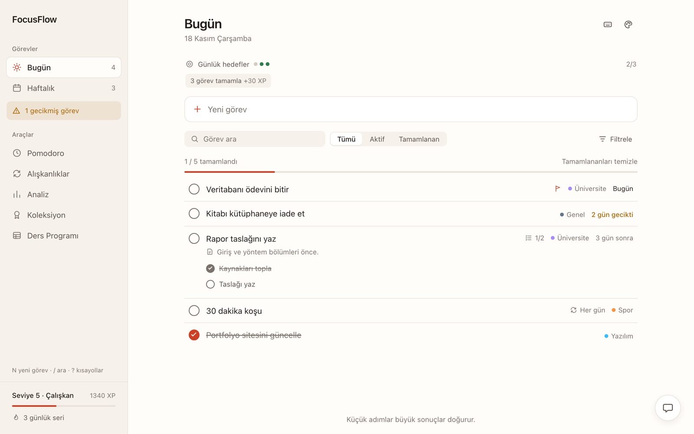
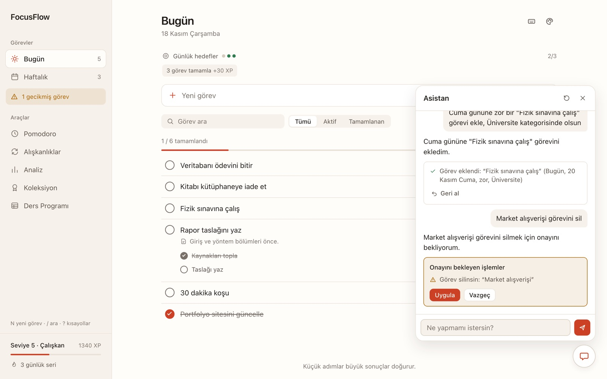
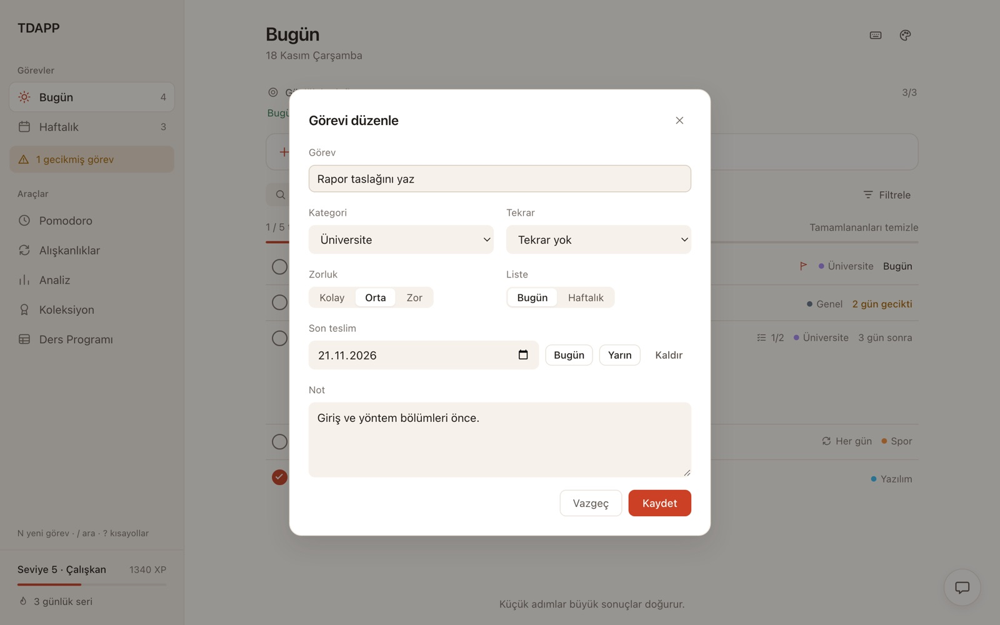
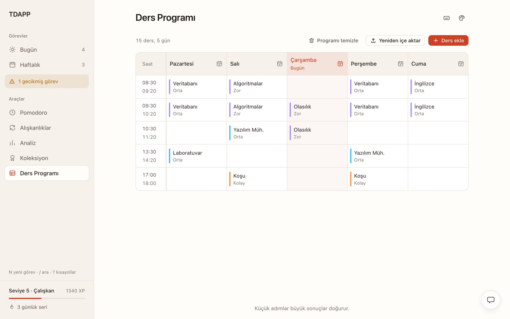
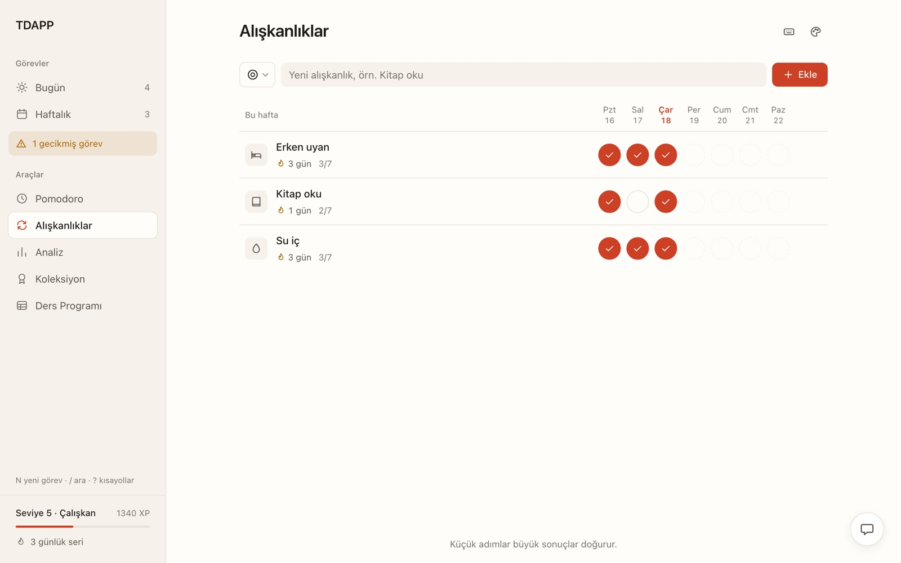
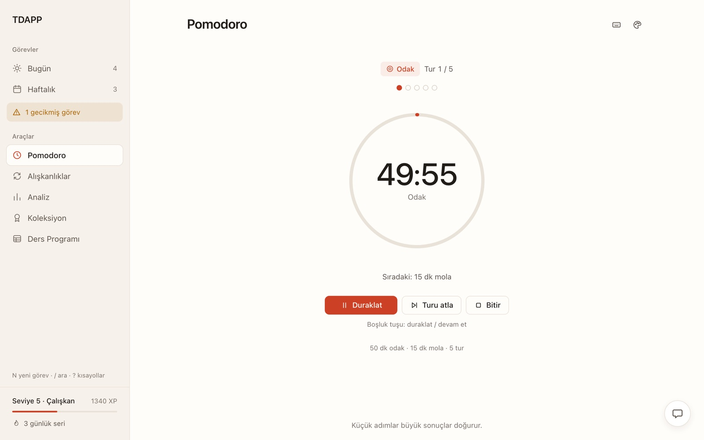
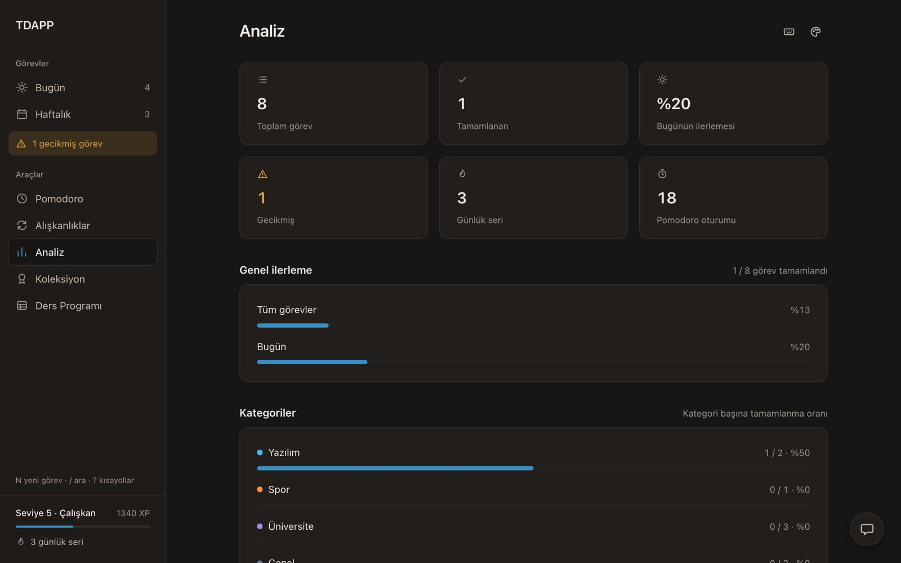
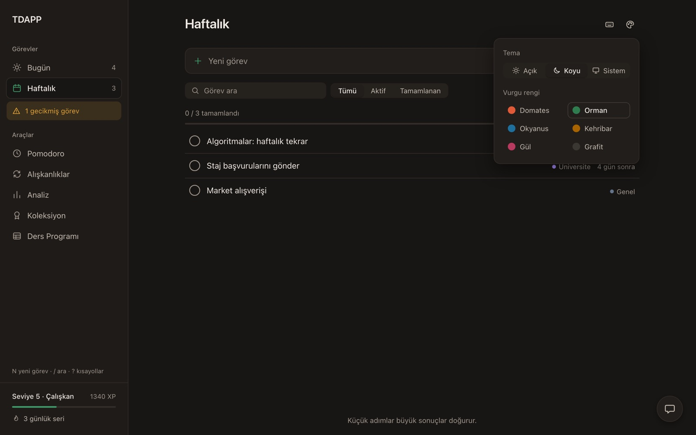

# ⏱ TDAPP - Görev ve Odak Yöneticisi - Web & Masaüstü


**TDAPP**, günlük ve haftalık görevleri, Pomodoro oturumlarını, alışkanlıkları ve ders programını tek yerde toplayan bir görev ve odak yöneticisidir. Kendi bilgisayarınızda çalışır: hesap açmak gerekmez, veriler ev klasörünüzdeki tek bir dosyada durur. Tarayıcıda ya da bağımsız bir masaüstü penceresinde kullanılabilir.

---

## ✨ Öne Çıkan Özellikler

* 📋 **Bugün ve Haftalık listeler:** Görevler kategori, zorluk, son teslim ve tekrar bilgisiyle eklenir. Alt görev ve not eklenebilir, sürükleyerek sıralanır.
  * Haftalık listedeki bir görev tek tıkla bugüne eklenir; biri tamamlanınca diğeri de tamamlanır.
  * Tekrarlayan görevler (her gün, hafta içi, her hafta) günü gelince kendiliğinden oluşur.
  * Geciken görevler "2 gün gecikti" diye işaretlenir ve kenar çubuğunda sayısı görünür.
* ✏️ **Görev düzenleme:** Ad, kategori, zorluk, liste, son teslim, tekrar ve not tek pencereden değişir. Başlığa çift tıklamak yalnızca adı değiştirir.
* 🍅 **Pomodoro:** Odak süresi, mola süresi ve tur sayısı seçilir; sayaç turlar arasında kendiliğinden geçer. Boşluk tuşu başlatır ve duraklatır, kalan süre sekme başlığında görünür.
* 🔁 **Alışkanlıklar:** Haftalık görünümde gün gün işaretlenir. Her alışkanlığın serisi ve o haftaki sayısı (4/7) yanında yazar.
* 🗓 **Ders programı:** CSV yapıştırarak ya da tek tek ders ekleyerek kurulur. Bir günün dersleri tek tıkla bugünün görevlerine aktarılır.
* 🤖 **Asistan:** Görevleri, alışkanlıkları ve ders programını yazarak yönetir ("Cuma gününe zor bir Fizik sınavına çalış görevi ekle").
  * Konuşmanın öncesini hatırlar; "onu yarına al" dediğinizde hangi görevi kastettiğinizi bilir.
  * Silme ve temizleme işlemlerini uygulamadan önce onay ister.
  * Yaptığı her değişikliğin altında ne yaptığı yazar ve tek tıkla geri alınır.
* 📊 **Analiz ve koleksiyon:** Tamamlama oranları, kategori dağılımı ve haftalık rapor. Tamamlanan görevler XP kazandırır; seviye, seri rozetleri ve başarımlar ayrı bir sayfada toplanır.
* 🎯 **Günlük hedefler:** Her gün üç küçük hedef ("3 görev tamamla", "1 Pomodoro oturumu bitir") ek XP verir.
* 🎨 **Görünüm:** Açık, koyu ya da sistem teması ve altı vurgu rengi: Domates, Orman, Okyanus, Kehribar, Gül, Grafit.
* ⌨️ **Klavye kısayolları:** Yeni görev, arama, sayfa geçişi ve asistan klavyeden açılır (liste aşağıda).
* ↩️ **Geri alma:** Silinen görev, temizlenen tamamlanmışlar ve asistanın yaptığı değişiklikler geri alınabilir.
* 💾 **Veri güvenliği:** Veriler diske anında kaydedilir, günde bir yedek alınır ve son yedi yedek tutulur. Veri yüklenemezse hiçbir şey kaydedilmez; böylece boş bir ekran dosyanın üzerine yazamaz.
* ♿ **Erişilebilirlik:** Klavyeyle gezilebilir, odak halkası görünür, düğmelerin ekran okuyucu etiketleri vardır, "Hareketi Azalt" açıkken animasyonlar kapanır. Dar ekranda kenar çubuğu menüye dönüşür.

---

## 📸 Ekran Görüntüleri

| Bugün | Asistan |
|:---:|:---:|
|  |  |
| Günlük hedefler, görev ekleme satırı ve liste. Geciken görev kehribar renginde, zor görevde bayrak var. | Eklenen görev listede hemen görünür. Silme isteği "Uygula / Vazgeç" kartıyla onay bekliyor. |

| Görev Düzenleme | Ders Programı |
|:---:|:---:|
|  |  |
| Bir görevin bütün alanları tek pencerede. "Bugün" ve "Yarın" düğmeleri tarihi tek tıkla ayarlar. | Haftalık tablo. Bugünün sütunu vurgulu; sol kenardaki çizgi dersin kategorisini gösterir. |

| Alışkanlıklar | Pomodoro |
|:---:|:---:|
|  |  |
| Her satırda seri ve haftalık sayı. Gelecek günler soluk ve tıklanamaz. | Beş turluk oturumun ilk odak turu. Altında sıradaki aşama yazıyor. |

| Analiz (koyu tema, Okyanus) | Görünüm (koyu tema, Orman) |
|:---:|:---:|
|  |  |
| Özet sayılar, genel ilerleme ve kategori başına tamamlanma oranı. | Tema ve vurgu rengi başlıktaki palet düğmesinden seçilir. |

---

## ⌨️ Klavye Kısayolları

| Kısayol | İşlev |
|:---:|:---|
| `N` | Yeni görev yaz |
| `/` | Görevlerde ara |
| `⌘ K` / `Ctrl K` | Asistanı aç veya kapat |
| `1` – `7` | Sayfalar arasında geç |
| `⌘ Z` / `Ctrl Z` | Silinen son görevi geri al |
| `Boşluk` | Pomodoro'yu başlat ya da duraklat |
| `Esc` | Açık pencereyi kapat |
| `?` | Kısayol listesini göster |

---

## 🛠 Teknik Detaylar & Mimari

* **Sunucu:** Python ve Flask (`server.py`). Arayüz dosyalarını sunar, veriyi okur ve yazar, asistan isteklerini Gemini'ye iletir.
* **Arayüz:** Çerçeve kullanılmadan, ES modülleriyle yazılmış JavaScript. Derleme adımı yoktur; her sayfa `js/components/` altında kendi dosyasındadır.
* **Durum yönetimi:** Bütün veri tek bir `Store` sınıfında tutulur (`js/store.js`). Bileşenler olaylara abone olur, değişiklikler 300 ms'de bir toplu kaydedilir.
* **Veri:** `~/TDAPPData/tdapp_data.json`. Yazma önce geçici dosyaya yapılır, sonra asıl dosyanın yerine konur; yarıda kesilen bir kayıt dosyayı bozmaz. Yedekler aynı klasördeki `backups/` altındadır.
* **Tema:** Renklerin tamamı CSS değişkenleridir (`css/style.css`). Tema `data-theme`, vurgu rengi `data-accent` özniteliğiyle değişir; yeni bir vurgu rengi eklemek birkaç satırdır.
* **Simgeler:** Uygulamanın içine gömülü çizgi simgeler (`js/utils/icons.js`). Yazı tipi sistem yazı tipidir; arayüz internet olmadan da aynı görünür.
* **Asistan:** Model yanıtı JSON olarak döner; içindeki eylemler tarayıcıda doğrulanır ve uygulamanın kendi işlevleriyle uygulanır. Tanınmayan ya da geçersiz eylemler atlanır.
* **Masaüstü:** `desktop_app.py`, sunucuyu arka planda başlatır ve arayüzü pywebview penceresinde açar.

```
TDAPP/
├── server.py            # Flask sunucusu ve asistan uç noktası
├── desktop_app.py       # Masaüstü penceresi
├── index.html
├── css/
│   ├── style.css        # Renkler, ortak parçalar, kenar çubuğu, görev sayfaları
│   ├── ai-chat.css      # Asistan
│   ├── pomodoro.css
│   ├── habits.css
│   ├── analytics.css    # Analiz, koleksiyon, haftalık rapor
│   └── schedule.css     # Ders programı
├── js/
│   ├── app.js           # Sayfa geçişleri, kısayollar, görünüm
│   ├── store.js         # Durum yönetimi ve kaydetme
│   ├── components/      # Sayfalar ve bileşenler
│   └── utils/           # Yardımcılar ve simgeler
├── requirements.txt
└── .env.example
```

---

## 🚀 Kurulum & Çalıştırma

Python 3.10 ya da üstü gerekir.

1.  Bu depoyu bilgisayarınıza klonlayın:
    ```bash
    git clone https://github.com/aliyakarr9/FocusFlowPro.git
    cd FocusFlowPro
    ```
2.  Sanal ortam oluşturup bağımlılıkları kurun:
    ```bash
    python3 -m venv .venv
    source .venv/bin/activate      # Windows: .venv\Scripts\activate
    pip install -r requirements.txt
    ```
3.  Asistanı kullanacaksanız anahtarınızı ekleyin (isteğe bağlı):
    ```bash
    cp .env.example .env
    ```
    `.env` dosyasını açıp `GEMINI_API_KEY` değerine [Google AI Studio](https://aistudio.google.com/apikey)'dan aldığınız anahtarı yazın.
4.  Uygulamayı başlatın:
    ```bash
    python3 server.py          # tarayıcıda: http://localhost:3000
    ```
    ya da bağımsız pencerede:
    ```bash
    python3 desktop_app.py
    ```

---

## 🔒 Veriler ve Asistan Hakkında

* Görevleriniz, alışkanlıklarınız ve ders programınız yalnızca kendi bilgisayarınızda, `~/TDAPPData` klasöründe durur. Analiz sayfasından dışa aktarılabilir ve yeniden içe aktarılabilir.
* Asistan isteğe bağlıdır; anahtar girilmezse uygulamanın geri kalanı eksiksiz çalışır.
* Asistana yazdığınızda mesajınızla birlikte görev başlıklarınız, alışkanlık adlarınız ve ders programınız yanıt üretilebilmesi için Google'ın Gemini servisine gönderilir. Bunun dışında hiçbir veri bilgisayarınızdan çıkmaz.
* `.env` dosyası depoya girmez; anahtarınızı kimseyle paylaşmayın.

---

## 🤝 Katkıda Bulunma

Yeni bir vurgu rengi eklemek, bir sayfayı geliştirmek veya mevcut bir hatayı düzeltmek isterseniz:
1. Projeyi *fork* edin.
2. Yeni bir dal (branch) oluşturun (`git checkout -b feature/yeni-ozellik`).
3. Değişikliklerinizi commit edin (`git commit -m 'Yeni özellik eklendi'`).
4. Dalınıza (branch) push yapın (`git push origin feature/yeni-ozellik`).
5. Bir Pull Request (PR) oluşturun.

---

👨‍💻 **Geliştiren & Tasarlayan:** [Ali Yakar](https://github.com/aliyakarr9)  
📧 İletişim, işbirlikleri ve geri bildirim için GitHub üzerinden bana ulaşabilirsiniz.


